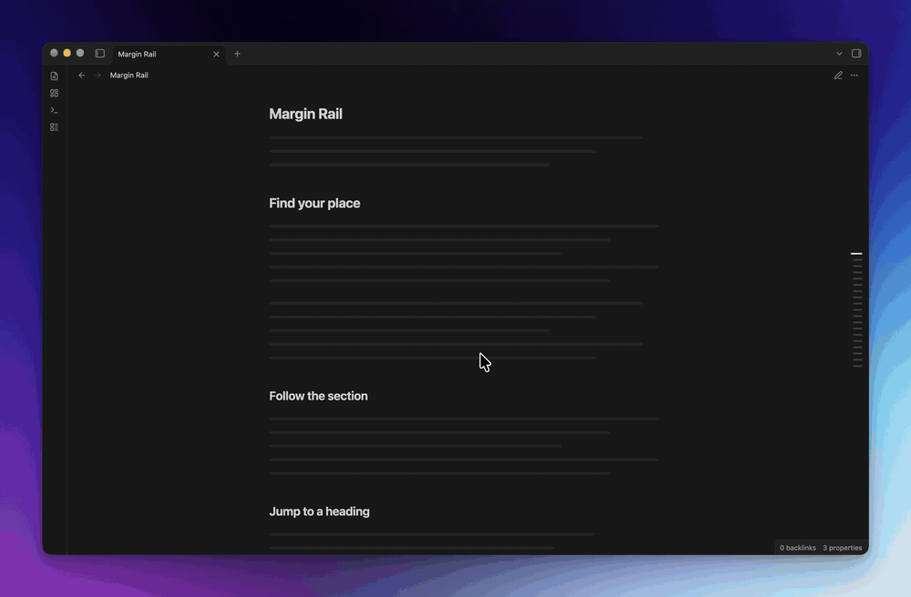
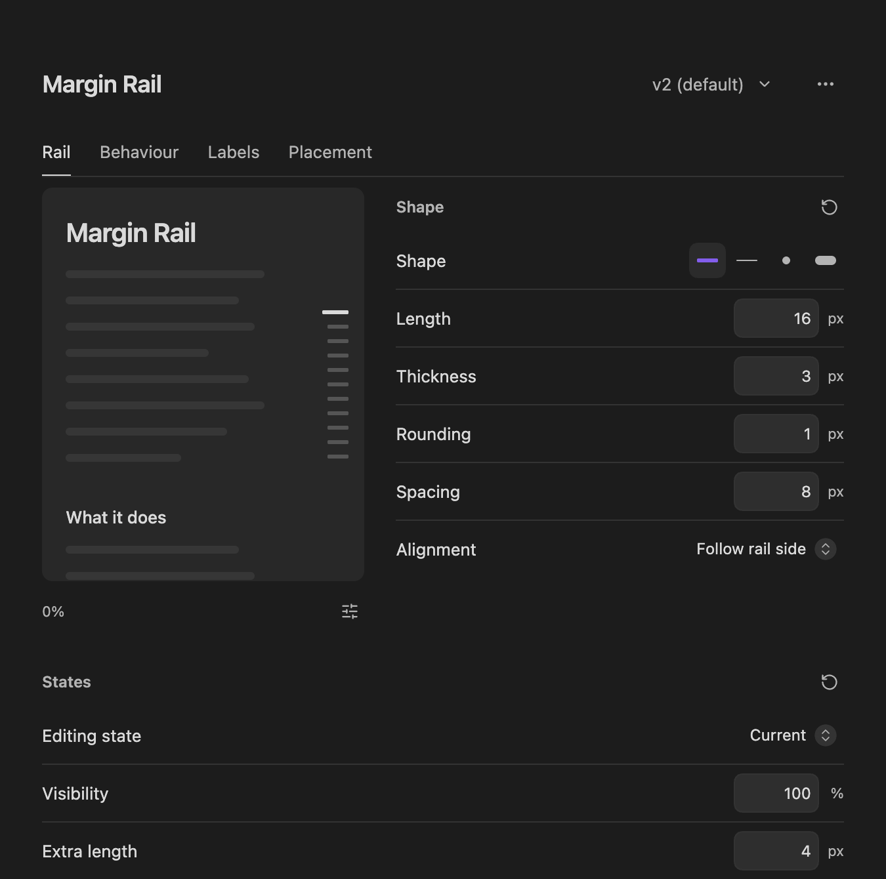

# Margin Rail

A heading rail for Obsidian. See where you are in a long note, preview headings,
and jump between sections without opening a sidebar. Works in reading and editing views.

[Watch the video](https://github.com/Mars-den/margin-rail/blob/main/images/margin-showcase.mp4)

## Install

In **Settings → Community plugins → Browse**, search for **Margin Rail**,
then install and enable it.

Manual installation

Download `main.js`, `manifest.json`, and `styles.css` from the
[latest release](https://github.com/Mars-den/margin-rail/releases/latest) into
`.obsidian/plugins/scrollspy-rail/` in your vault. Restart Obsidian and enable
Margin Rail.

## Navigate

- **Hover** to preview a heading and its text.
- **Click** to jump, or **drag** along the rail to scroll.
- **Scroll or swipe** over a long rail to reach more headings.
- **Bookmark** headings from their preview. Requires Obsidian’s Bookmarks core plugin.
- **Keyboard:** Tab to the rail, select with arrow keys or Home/End, then press Enter.

## Make it yours

Choose a preset, then adjust its shape, colours, labels, placement, and behaviour
in **Settings → Margin Rail**. Try changes in the scrollable preview and save
your setup as a preset.

Tracking can follow **section length** (recommended), **heading position**, or
**equal scroll steps**. Turn it off to use the rail for navigation alone.

For more control, use CSS snippets or share presets as JSON files.
See the [customization reference](docs/CUSTOMIZATION.md).

## On phones

The rail is hidden by default. Enable it under
**Placement → Visibility → On phones**, either in landscape only or in both orientations.

## Rail missing?

Check **Placement** for heading-count, pane-width, and phone visibility settings.
You can also run **Margin Rail: Refresh rail and show status** from the command palette.

[Report a problem](https://github.com/Mars-den/margin-rail/issues) with your
Obsidian version, device, and whether it happened while reading or editing.

---

Requires Obsidian 1.2.7 or later. Works locally, with no network requests or usage tracking.

[MIT](LICENSE) · Maintained by [Mars-den](https://github.com/Mars-den) · Developed with AI assistance.
